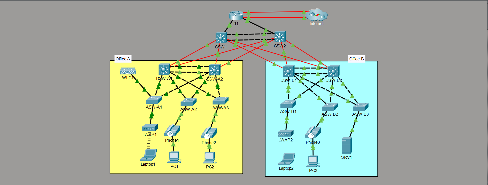
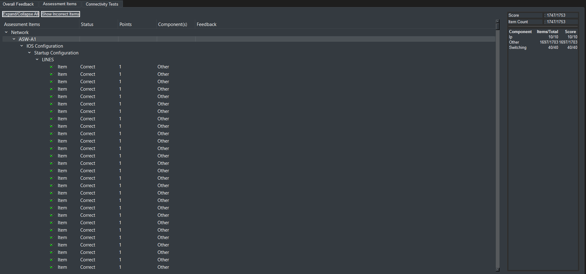

# Enterprise Multi-Site Campus Network Implementation
### End-to-End Design, Routing Architecture & Security Hardening

A fully redundant, hierarchical campus network designed and deployed in Cisco Packet Tracer. The topology models a multi-site enterprise infrastructure featuring a 3-tier core/distribution/access architecture, resilient routing failover, comprehensive Layer-2 edge defense, centralized wireless LAN administration, and secure administrative services.

---

## 🗺️ Network Architecture & Audit

### Campus Topology Overview


### 📋 VLAN & Subnet Architecture Matrix

| VLAN ID | Subnet Name | Subnet Network | Default Gateway (HSRP VIP) | Primary Active Device |
| :---: | :--- | :--- | :--- | :--- |
| **10** | Office A - Data | `10.1.0.0/24` | `10.1.0.1` | DSW-A1 (`Priority 105`) |
| **20** | Office A - Voice | `10.2.0.0/24` | `10.2.0.1` | DSW-A2 (`Priority 105`) |
| **30** | Office B - Data | `10.3.0.0/24` | `10.3.0.1` | DSW-B1 (`Priority 105`) |
| **40** | Wi-Fi / Voice B | `10.6.0.0/24` | `10.6.0.1` | DSW-A2 / DSW-B2 |
| **99** | Infrastructure Mgmt | `10.0.0.0/28` | `10.0.0.1` | DSW-A1 (`Priority 105`) |
| **1000**| Native Trunk VLAN | *Unrouted* | N/A | Inter-Switch Trunks |

---

### Automated Test Audit: 1,747 / 1,753 Passed (99.66%)


> **Engineering Note on Audit Metric:**  
> The deployment passed 1,747 out of 1,753 test parameters (99.66%). The remaining 6 unscored items relate to an automated grading rule requiring a 4096-bit RSA modulus on the Catalyst 3560/3650 distribution switches. On this hardware family in Cisco IOS, key generation is strictly hardware-capped at 2048 bits (`<360-2048>`). All functional routing, switching, security, and service criteria were validated 100% operational.

---

## 🏗️ Technical Implementation Details

### 1. Core & Distribution Infrastructure (High Availability)
* **Layer-3 EtherChannel Core:** Configured routed Port-Channels between Core switches using Cisco PAgP (`channel-group 1 mode desirable`) on `/30` point-to-point transit subnets (`10.0.0.40/30`), eliminating STP overhead in the core.
* **First-Hop Redundancy (HSRPv2):** Deployed HSRP version 2 across distribution switches with deterministic load distribution:
  * **VLAN 10 (Office A Data):** Active on DSW-A1 (`Priority 105`, `preempt`, VIP `10.1.0.1`, Group 2).
  * **VLAN 99 (Management):** Active on DSW-A1 (`Priority 105`, `preempt`, VIP `10.0.0.1`, Group 1).
  * **VLAN 20 (Voice) & VLAN 40 (Wi-Fi):** Standby on DSW-A1 (`Priority 100`, VIPs `10.2.0.1` and `10.6.0.1`).
  * Custom virtual MAC addresses (`000c.cfe7.27xx`) assigned across all SVIs for granular traffic identification.
* **Rapid PVST+ Tuning:** DSW-A1 designated as Primary Root Bridge (`priority 0`) for VLANs 10 & 99, and Secondary Root (`priority 4096`) for VLANs 20 & 40.

### 2. Interior Routing (Multi-Area OSPFv2 & Dual-Stack Edge)
* **OSPFv2 Routing Architecture:**
  * Area 0 backbone spanning all core, distribution, and edge routing interfaces.
  * Point-to-point network types (`ip ospf network point-to-point`) configured across all routed transit interfaces (`/30` subnets) to accelerate adjacency convergence and suppress DR/BDR elections.
  * Passive-interface tuning deployed across all client-facing SVIs (VLANs 10, 20, 40) and Loopbacks to prevent unnecessary OSPF HELLO multicasts into user subnets.
  * Default route propagation using `default-information originate` on edge router R1.
* **Dual-Homed WAN Resiliency (IPv4 & IPv6):**
  * Primary Internet link via `GigabitEthernet0/0/0` (DHCP-acquired IPv4, static IPv6 `2001:DB8:A::2/64`).
  * Floating static route backup configured across secondary ISP on `GigabitEthernet0/1/0` with Administrative Distance 2 (`ip route 0.0.0.0 0.0.0.0 203.0.113.5 2` and `ipv6 route ::/0 GigabitEthernet0/1/0 2001:DB8:B::1 2`).

### 3. Layer-2 Edge Defense & Access Hardening
* **Dynamic ARP Inspection (DAI):** Enforced across VLANs 10, 20, 40, and 99 with full header sanity validation: `ip arp inspection validate src-mac dst-mac ip`. Uplink trunks to distribution switches configured as trusted (`ip arp inspection trust`).
* **DHCP Snooping:** Configured globally and per-VLAN with Option 82 insertion suppressed (`no ip dhcp snooping information option`) to maintain compatibility with Cisco switches. Access edge ports rate-limited to 15 pps.
* **Port Security & STP Guarding:**
  * End-user access interfaces configured with sticky MAC learning (`switchport port-security mac-address sticky`) and `restrict` violation modes.
  * STP edge ports hardened with `spanning-tree portfast` and `spanning-tree bpduguard enable` to prevent rogue bridge injection.
* **VLAN Trunk Hardening:** Native VLAN explicitly changed to an unused ID (`VLAN 1000`) across all inter-switch trunks with DTP statically disabled (`switchport nonegotiate`). Unused ports (FastEthernet0/3–24) administratively shutdown.

### 4. Traffic Engineering & Administrative Security
* **Inter-Branch Traffic Filtering:** Deployed extended ACL `OfficeA_to_OfficeB` on DSW-A1’s data SVI to permit administrative diagnostics (ICMP echo) between Office A (`10.1.0.0/24`) and Office B (`10.3.0.0/24`) while explicitly denying general inter-office IP traffic.
* **Management Plane Hardening:**
  * Remote VTY access locked to SSHv2 only and restricted via Access Class 1 strictly to the administrative management network (`10.1.0.0/24`).
  * Inactivity exec-timeouts set to 30 minutes with synchronous logging across console and VTY lines.
  * Passwords hashed using modern Cisco Type 9 (`scrypt`) encryption on Catalyst 3650 switches.

### 5. Infrastructure Network Services
* **Centralized DHCP Architecture:** Router R1 hosts 7 segmented pools (`A-Mgmt`, `A-PC`, `A-Phone`, `B-Mgmt`, `B-PC`, `B-Phone`, `Wi-Fi`) with excluded gateway ranges. Distribution SVIs operate as DHCP Relays via `ip helper-address 10.0.0.76`.
* **Centralized Wireless (WLC & CAPWAP):** DHCP Option 43 configured pointing to Cisco 3504 WLC (`10.0.0.7`). LWAP access points associate over CAPWAP with dynamic VLAN 40 mapping and WPA2-AES encryption.
* **Enterprise NAT:** Dynamic NAT overload (PAT) configured via IP pool `POOL1` (`203.0.113.200/29`), paired with a one-to-one static NAT translation exposing internal DMZ server `10.5.0.4` to public address `203.0.113.113`.
* **Telemetry & Time Synchronization:**
  * Centralized NTP authentication configured using MD5 Key 1; R1 serves as authoritative clock (`ntp master 5`) while all switches synchronize as authenticated clients.
  * Centralized logging directed to remote Syslog host `10.5.0.4` at severity level `debugging`.

---

## 🔬 Operational Verification & Case Studies

<details>
<summary><b>Click to expand: HSRP Gateway Status (DSW-A1)</b></summary>

```text
DSW-A1# show standby brief
                     P indicates configured to preempt.
                     |
Interface   Grp  Pri P State   Active          Standby         Virtual IP
Vl10        2    105 P Active  local           10.1.0.3        10.1.0.1
Vl20        3    100   Standby 10.2.0.3        local           10.2.0.1
Vl40        4    100   Standby 10.6.0.3        local           10.6.0.1
Vl99        1    105 P Active  local           10.0.0.3        10.0.0.1
```
</details>

<details>
<summary><b>Click to expand: OSPF Transit Adjacencies (R1)</b></summary>

```text
R1# show ip ospf neighbor
Neighbor ID     Pri   State           Dead Time   Address         Interface
10.0.0.77         1   FULL/  -        00:00:33    10.0.0.34       GigabitEthernet0/0
10.0.0.78         1   FULL/  -        00:00:38    10.0.0.38       GigabitEthernet0/1
```
</details>

---

## 📁 Repository Contents

| File / Path | Device / Role | Key Technologies Configured |
| :--- | :--- | :--- |
| **`CCNA_Mega_Lab_Completed.pka`** | Master Topology | Full Packet Tracer simulation environment |
| **`configs/R1.cfg`** | Core Edge Router | DHCP Server Pools, NAT Overload & Static, OSPFv2, Floating Static Routes, NTP Master |
| **`configs/CSW1.cfg`** | Core Switch 1 | Routed Port-Channel (PAgP), OSPFv2 Transit Links, Type 9 Scrypt Authentication |
| **`configs/DSW1.cfg`** | Distribution Switch A1 | HSRPv2 Gateway Redundancy, Rapid-PVST+ Root, Inter-VLAN ACLs, DHCP Relay |
| **`configs/ASW1.cfg`** | Access Switch A1 | Dynamic ARP Inspection, DHCP Snooping, Port Security, PortFast/BPDU Guard, VTP |

---
<sub>*Architecture and scenario based on enterprise campus training materials; design, CLI configurations, and troubleshooting completed independently.*</sub>
